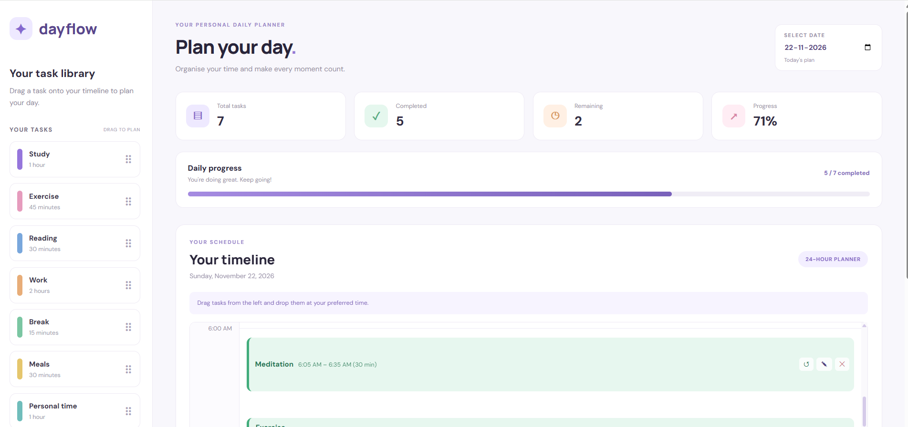
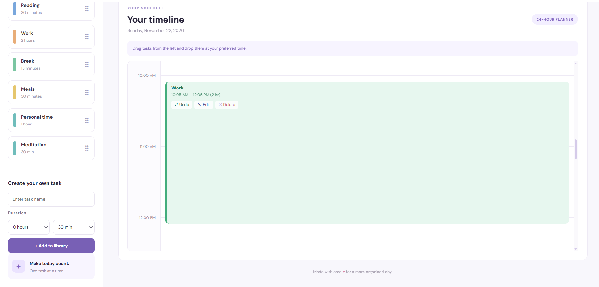

# Dayflow - Visual Day Planner

## Website Link

[https://parvanamohan.github.io/Day-Planner/](https://parvanamohan.github.io/Day-Planner/)

## Project Overview

Dayflow is a web-based visual day planner designed to help users organize their daily activities, plan schedules, and manage their time effectively.

The application provides a visual interface for organizing activities throughout the day. It aims to make daily scheduling easier, more intuitive, and more organized.

Dayflow is developed as an educational project using basic web technologies to demonstrate website development, interactive user interfaces, and practical time-management tools.

## Screenshots

### 1. Homepage



### 2. Create Activities



## Main Features

### 1. Visual Day Planning

Dayflow provides a visual interface that helps users organize their daily schedules and understand how their time is allocated throughout the day.

### 2. Activity Management

Users can create and manage activities according to their daily requirements, making it easier to organize tasks and routines.

### 3. Time Management

The planner helps users allocate time to different activities and structure their daily schedules more effectively.

### 4. Interactive User Interface

The application provides an interactive interface designed to make planning and managing activities straightforward and convenient.

### 5. Responsive Design

The website is designed to provide a usable experience across different screen sizes, including desktop computers, laptops, tablets, and mobile devices.

## Technologies Used

- **HTML5** — Used to create the structure and content of the website.
- **CSS3** — Used for styling, layout, and visual presentation.
- **JavaScript** — Used to implement functionality, user interactions, and dynamic behaviour.

The project is a client-side web application and does not require a separate backend server or database for its basic operation.

## Project Structure

```text
Day-Planner/
│
├── index.html
├── script.js
├── style.css
├── rateme.md
├── README.md
│
└── Screenshots/
    ├── homepage.png
    └── create.png
```

## How the Application Works

Dayflow follows a simple workflow:

```text
Open the Website
       |
       v
View the Planner
       |
       v
Create and Organize Activities
       |
       v
Allocate Time to Activities
       |
       v
Review the Daily Schedule
```

The application uses HTML to define the page structure, CSS to control the visual appearance, and JavaScript to handle supported interactions.

## Educational Purpose

Dayflow was created as an educational learning project to demonstrate the practical application of fundamental web development concepts.

The project provides an opportunity to work with HTML, CSS, and JavaScript while exploring interactive interface design, activity organization, and time management.

It also demonstrates how basic web technologies can be combined to develop a useful application that addresses an everyday need.

## Methodology

The project follows a client-side development approach.

- **Structure:** HTML defines the content and layout of the application.
- **Styling:** CSS provides the visual design and responsive presentation.
- **Functionality:** JavaScript implements the application's interactive behaviour.

The application is intended for personal scheduling and educational demonstration. Its functionality depends on the features implemented in the current version.

## Future Enhancements

The project can be further improved by adding:

- Task reminders and notifications.
- Recurring activities and daily routines.
- Weekly and monthly schedule views.
- Improved activity categorization.
- Task completion and progress tracking.
- More customization options for schedules.
- Improved accessibility and mobile usability.
- Data export and schedule backup options.

## Disclaimer

Dayflow has been developed as an educational learning project by **Parvana Mohan**.

The application is intended to demonstrate web development concepts and support personal time management. It is not intended to replace professional productivity or project-management software.

## Author

**Developed by:** Parvana Mohan

**Project Name:** Dayflow - Visual Day Planner

**Website:** [https://parvanamohan.github.io/Day-Planner/](https://parvanamohan.github.io/Day-Planner/)

